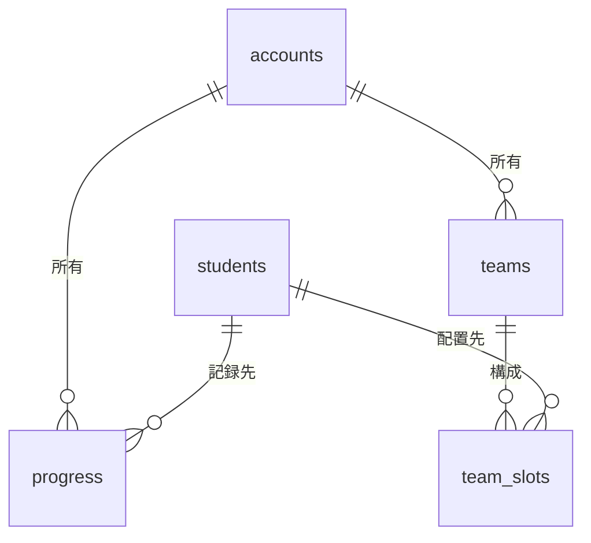

# シャーレ育成手帳の再設計

## 要件と判断の根拠

- 日本語で使う『ブルーアーカイブ』の個人向け育成・編成台帳。マスタの一覧・詳細と名前検索、学園・役割・配置・攻撃・防御・限定区分で絞り込み。育成記録の有無でも絞り込める。
- 生徒の育成記録は利用者ごとに独立する。Lv、星、絆、EX／ノーマル／パッシブ／サブスキル、装備3枠、固有武器の★とLv、神名文字の所持・使用数、贈り物、メモを記録する。レコード未作成と登録済みで値が空の状態を区別し、部分更新では省略項目を保持する。
- 総力戦と合同火力演習の編成は、利用者ごとに作成・一覧・閲覧・編集できる。6枠の任意位置に生徒を指定し、助っ人を記録できる。スロットは一括置換する。ブラウザの画面とフォームで業務処理を提供する。
- 共有・共同編集、監査履歴、外部データ同期、マスタ編集 UI、外部 REST と MCP は対象外。新環境で開始し、旧データの移行は省略する。
- 要件の根拠は旧 main の README が正本として参照する `docs/superpowers/specs/2026-04-10-workers-d1-redesign-design.md` と今回の依頼。凍結された旧 `docs/spec/` は育成項目やモードの背景確認に使った。GitHub CLI でオープン・クローズ済み Issue を確認し、該当件数は0件。元の ChatGPT 設計会話は現環境で本文を取得できず、記載外の決定は未確認。
- 初期マスタを公式プロフィールなどで確認できた生徒に限定する。確認済みの衣装違いは別ID。通常版の名称には「通常」を付けない。日本版全体の網羅範囲と総数は未確認。ゲーム環境が変動するため、数値制約は台帳としての入力範囲とし、ゲーム内の解放条件を推測して強制する処理は設けない。

## 画面と入力

| 画面 | 操作 |
| --- | --- |
| ホーム | マスタの収録数、育成登録数、編成数から各一覧を開く。最近の編成を再開したり、未登録の育成を確認したりできる。 |
| 生徒一覧 | 名前・読みを検索し、フィルターを組み合わせる。登録状態と基本属性を確認して詳細を開く。URL に検索条件を保持し、18件ごとにページを分ける。 |
| 生徒詳細 | マスタ属性と登録状態を確認し、基本、スキル、装備・固有武器、神名文字・その他の順に記録する。空欄は値の消去、送信されなかった項目の省略は既存値の維持を意味する。 |
| 編成一覧 | モードで絞り込む。編成名とモードを入力して作成し、詳細へ進む。 |
| 編成詳細 | 名前・モード・メモと6枠を編集する。空き枠、通常、助っ人を表示する。変更をまとめて保存する。 |

スマホでは上部のナビゲーションを共通化し、検索を先に表示する。詳細フィルターは展開式、育成フィールドは2列、編成枠は縦並び。標準の入力と選択でタップ・キーボードに対応し、ドラッグ操作を要求しない。送信値のエラーは元のフォーム内に日本語で表示する。別端末で編成を保存済みの場合は、入力内容を保持して競合を知らせ、最新の編成を開く手段を提示する。表示日時は日本語と端末時間を使い、JavaScript が使えない場合は日本時間で表示する。

## データベース

- `accounts` の主キーは Cloudflare Access の検証済み JWT の `sub`。発行元は環境で固定。メールアドレスと JWT は永続化しない。
- `students` は固定 ID、名前と読み、学園、役割、前中後、攻撃・防御、基礎レアリティ、限定区分を持つ。未確認の属性は NULL。マスタ参照には削除制約を付ける。少数の初期マスタは日本語を正規化した部分一致検索とし、必要になった時点で検索専用索引を検討する。
- `progress` は `(account_id, student_id)` が主キー。各育成項目は nullable で、値域とメモ長を DB でもチェックする。ユーザー条件付きの単一 UPSERT で、送信された列だけ更新する。空パッチは400。異なる項目への並行パッチは互いの値を上書きしない。
- `teams` は UUID、所有者、名前、モード、メモ、リビジョン、作成・更新日時を持つ。所有者・更新日時と、所有者・モード・更新日時の索引を持つ。読み書きは必ず所有者を指定し、他人の UUID には404を返す。
- `team_slots` は `(team_id, position_index)` が主キー。位置0〜5、助っ人の真偽値、マスタ外部キーをチェック。親編成の削除に追従する。元要件から同一生徒や助っ人の件数には追加制約を設けない。
- 編成更新は D1 の `batch()` を使い、旧リビジョンと所有者の一致を確認して新リビジョンを採番し、同じリビジョンを条件に既存枠を削除して挿入する。読み取りも同じバッチで行う。競合時は変更が適用されず409を返す。失敗したステートメントはバッチ全体をロールバックする。

## 技術・認証

| 選択肢 | 判断 |
| --- | --- |
| Workers + D1 | 採用。6枠の更新をトランザクション化でき、外部接続や別契約を要しない。 |
| Workers + 外部 PostgreSQL | SQL の拡張機能は利用できるが、MVP では追加の接続・認証・運用に見合う用途がない。 |
| Workers + KV／Durable Objects | KV の整合性モデルは置換に合わない。Durable Objects の利用者別 DB は、共通マスタと SQL の結合を別途実装する必要がある。 |
| SSR と標準フォーム | 採用。軽量な TypeScript Worker が HTML を返す。検索・登録・編成編集を初回描画から利用できる。外部フォント、JS フレームワーク、ORM を必要としない。 |
| SPA／UI フレームワーク | 複雑なクライアント状態が要件にないため、ルーティングやデータ管理の二重化を避ける。 |

ブラウザの入口に既存と同等のメール許可リストを持つ Cloudflare Access を設定する。Worker 内でも JOSE で JWT の RS256 署名、固定発行元・対象環境の audience、有効期限、利用者の `sub` を検証する。ブラウザの変更要求は同一オリジンのみ。

## 検証とリリース

1. Codex Cloud の新ブランチで型検査・ビルド・D1 へのローカル移行と再適用・HTTP 統合テスト・スマホ E2E を実行する。GitHub Actions の CI を PR で再実行する。
2. 新規プレビュー Worker、空のプレビュー D1、専用 Access アプリを用意する。アクセス拒否、許可ユーザーの主要画面、二人のユーザー間の分離、部分更新と編成の競合を確認する。許可ユーザーで行う検証に使うのは合成データのみ。
3. 別名の本番 Worker、空の本番 D1、専用 Access アプリに同じコミットを展開し、プレビューの確認項目を本番に対して読み取り中心で追試する。旧 Git integration の対象ブランチや URL は切り替えず、新 URL を案内する。
4. 運用上の切り戻しは旧 URL に戻ること。新 Worker 内のコードを戻す場合は D1 スキーマ互換を確認してから旧バージョンを選ぶ。Worker のバージョン復元に D1 の復元は含まれない。新旧の台帳データは独立しており、旧 URL に戻した場合は新環境での記録が表示されない。

参照資料

- [D1 Database API](https://developers.cloudflare.com/d1/worker-api/d1-database/)
- [Cloudflare Access for Workers](https://developers.cloudflare.com/workers/configuration/cloudflare-access/)
- [Cloudflare Access の JWT 検証](https://developers.cloudflare.com/cloudflare-one/access-controls/applications/http-apps/authorization-cookie/validating-json/)
